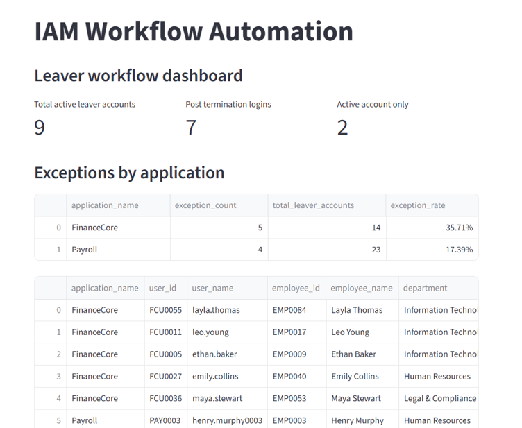

> Note: All data used in this project is synthetic and created for demonstration purposes only.

# IAM Workflow Automation

A personal project exploring how SQL and Python automation can be used to automatically perform and report IAM control testing.

## Current Functionality

### Leaver Controls
- Normalises application access data from different source formats
- Reconciles HR leaver data against multiple application access listings
- Identifies active accounts belonging to terminated employees
- Identifies post-termination login activity
- Consolidates exceptions across FinanceCore and Payroll
- Automates control execution and CSV reporting using Python
- Provides Streamlit reporting for key control metrics and exception details

## Dashboard Preview

## Technology

- SQL / DuckDB
- Python
- pandas
- Streamlit

## Current Workflow

HR and application data  
→ Data normalisation  
→ SQL control testing  
→ Consolidated exceptions  
→ Python automation  
→ Streamlit reporting

## Project Status

Completed:
- Leaver Workflow V1

Planned:
- Joiner, including access approval evidence processing and planned AI-assisted evidence extraction
- Leaver Workflow V2, including AI-Assisted Data Cleaning and Evidence Processing, with Automated Testing Results Table Generation
- Mover
- Privileged Access
- Passwords Configuration
- Change Management SoD